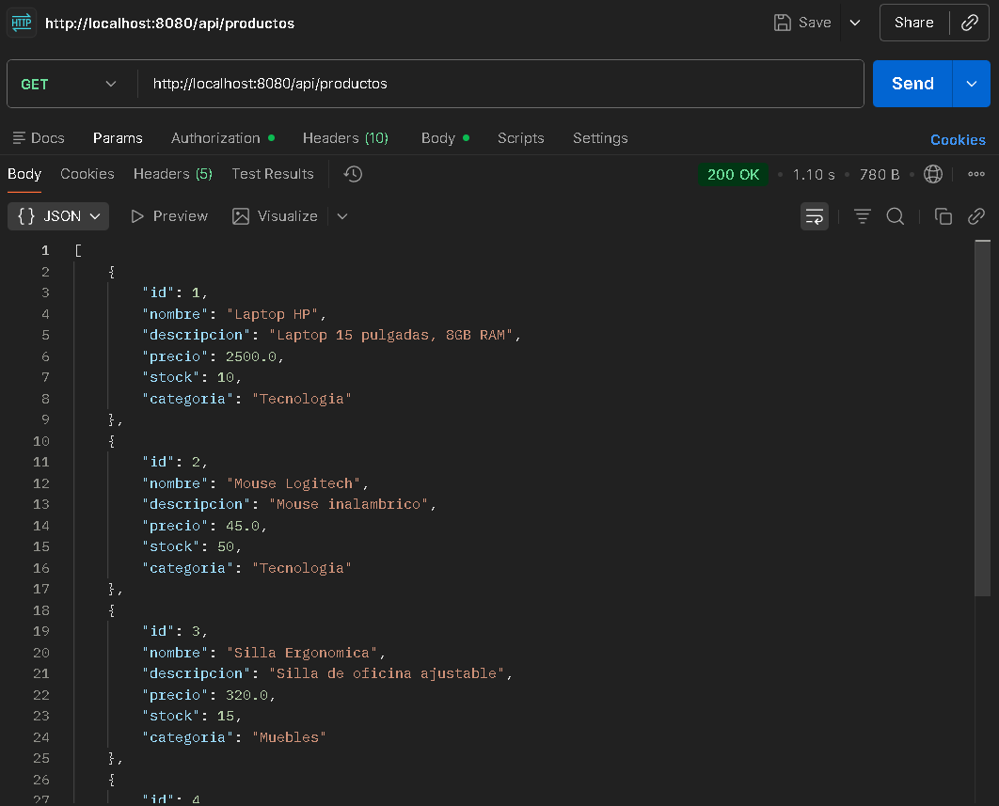
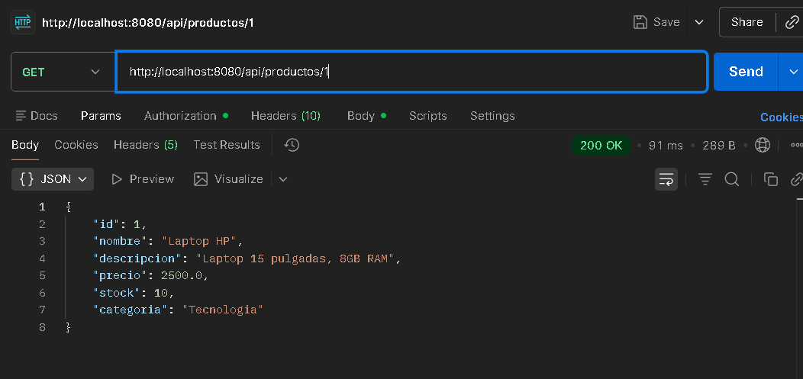
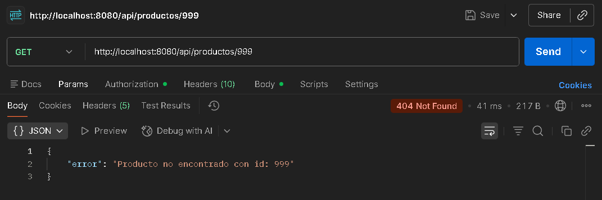

## Tecnologías

- Java 17
- Spring Boot 3.5 (Spring Web, Spring Data JPA)
- Base de datos H2 en memoria
- Maven (incluye Maven Wrapper, no hace falta instalar Maven)

## Estructura del proyecto

controller → service → repository
Entidad: Producto

Campo	Tipo	Restricciones
id	Long	PK, autoincremental
nombre	String	Not null
descripcion	String	Not null
precio	Double	Not null
stock	Integer	Not null
categoria	String	Not null

## Cómo ejecutar el proyecto

### 1.

- Tener instalado JDK 17 o superiror

  ```bash
  java -version
  ```

### 2. iniciar la aplicación

En Windows:

```bash
.\mvnw.cmd spring-boot:run
```


La aplicación queda corriendo en `http://localhost:8080`. 

a continuacion voy a poner las capturas del llamada a los endpoints
  

